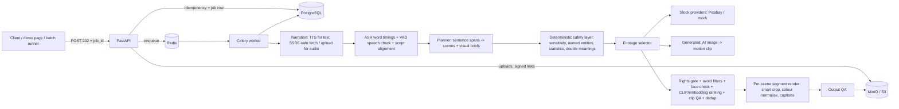

# IncuBrix B-roll Engine

Turns a **voiceover (MP3/WAV/M4A, ≤10 min)**, a **script**, or an **IncuBrix scene list** into finished,
licence-clean B-roll videos: one MP4 per requested aspect ratio (16:9, 9:16, 1:1; H.264/AAC, 30 fps,
1080-class), narration-timed captions (`captions.srt`, optionally burned in), a scene-by-scene
`timeline.json` (clip, source, licence, attribution, AI flag, selection reason, relevance score) and a
`manifest.json` (models, versions, settings, seed, timings, cost, warnings, rights, QA results).

Design rule: **models propose, code decides.** The LLM/rules planner only groups sentence indices and
writes visual briefs. Deterministic Python owns timestamps, coverage, rights, uniqueness, safety and rendering.

## Architecture



Stage by stage (`app/services/pipeline.py`):

| Stage | Progress | What happens |
|---|---|---|
| narration | 5 | Script/scenes → TTS → canonical 48 kHz WAV. Audio → SSRF-safe download or upload → ffprobe validation → WAV |
| transcription | 14 | Silence/music check (volumedetect + Silero VAD), ASR with word timestamps. For text input, the script's exact words are aligned onto the ASR timings |
| scene_planning | 25 | Sentence/phrase spans → planner groups them → frame-exact scenes with cuts at the midpoint of pauses → min-length merge → coverage validation |
| footage | 32–62 | Per scene: multi-query search, rights gate, avoid/safety filters, embedding + CLIP thumbnail scoring, stock-vs-generated rule, download, black/freeze QA, perceptual dedup |
| captions | 63 | Word-timed SRT cues |
| rendering | 65–90 | One segment per scene × ratio (exact frame count, saliency crop or blur-pad, colour normalisation, burned captions), then stream-copy concat + narration mux |
| judging | 91 | Optional independent judge (Gemini vision) scores each clip 1–5 |
| uploading | 95–100 | Outputs, segments, clips, timeline, manifest → S3; signed links in job status |

## Quick start (no API keys)

```bash
cp .env.example .env              # optional; defaults run keyless
docker compose up --build -d      # api :8000, worker, postgres, redis, minio (:9000, console :9001)
curl -s localhost:8000/ready      # {"status":"ready",...}
open http://localhost:8000        # demo page   (API docs: http://localhost:8000/docs)
docker compose run --rm tests     # all tests: unit + integration + e2e, no keys
python scripts/batch_runner.py --input tests/scenarios/core --api http://localhost:8000 --output test-results/core
```

Without keys the compose stack uses real local models (faster-whisper ASR, fastembed text embeddings,
CLIP visual scoring, YuNet face detection), plus mock TTS (a tone), the rules planner, the mock stock
library and the mock image generator. The first job downloads the local models (cold start).

### Real providers

Put these in `.env`, then run `docker compose up -d` again:

```dotenv
GEMINI_API_KEY=...            # https://aistudio.google.com/apikey
TTS_PROVIDER=gemini
GEMINI_TTS_MODEL=...          # e.g. gemini-3.8-flash-tts (called via the Interactions API)
LLM_PROVIDER=gemini
GEMINI_TEXT_MODEL=...         # a current Gemini Flash model id
GENERATED_PROVIDER=gemini
GEMINI_IMAGE_MODEL=...        # a current Gemini image model id
JUDGE_PROVIDER=gemini
GEMINI_JUDGE_MODEL=...        # a current multimodal Gemini model id
FOOTAGE_PROVIDERS=pixabay
PIXABAY_API_KEY=...           # https://pixabay.com/api/docs/
```

Model IDs are deliberately not hard-coded. Take them from https://ai.google.dev/gemini-api/docs/models.
Leave a key blank and that provider stays mock.

## API

All routes are under `/api/v1/` (plus `/health`, `/ready`). The contract is [`openapi.yaml`](openapi.yaml)
(OpenAPI 3.1). It is generated from the running app (`python scripts/export_openapi.py`), and a test fails if it drifts.

| Method & path | Purpose |
|---|---|
| `POST /api/v1/broll/jobs` | Create a job. JSON (`audio_url` \| `script` \| `scenes`) or multipart (`audio_file` + `options` JSON). Returns **202** + `job_id` |
| `GET /api/v1/jobs/{job_id}` | Status (`queued`, `running`, `succeeded`, `failed`, `cancelled`), `stage`, `progress` 0–100, warnings, error, result links |
| `GET /api/v1/jobs/{job_id}/timeline` | The job's `timeline.json` |
| `POST /api/v1/jobs/{job_id}/scenes/{scene_id}/clip` | Swap one scene's clip; only that scene's segments are re-rendered (new job, 202) |
| `POST /api/v1/jobs/{job_id}/cancel` | Cancel (queued: immediately; running: at the next checkpoint) |
| `GET /api/v1/files/{key}` | File download, only with `STORAGE_BACKEND=local`. Compose returns presigned MinIO links instead |
| `GET /health`, `GET /ready` | Liveness; readiness of DB + Redis + MinIO (503 with details if any is down) |

Every POST needs **`Idempotency-Key`**. The same key with the same body returns the same job
(`Idempotent-Replayed: true`) and never runs the work twice. The same key with a different body returns `409 IDEMPOTENCY_CONFLICT`.
`X-Correlation-Id` is echoed back and appears on every log line for the request and its job.

```bash
# text -> narration -> video
curl -s -X POST localhost:8000/api/v1/broll/jobs -H 'Content-Type: application/json' -H 'Idempotency-Key: demo-1' \
  -d '{"script":"Cloud computing lets small teams rent servers. Trust is earned slowly.","aspect_ratios":["16:9","9:16"],"avoid":["alcohol"]}'
# audio upload
curl -s -X POST localhost:8000/api/v1/broll/jobs -H 'Idempotency-Key: demo-2' \
  -F audio_file=@voiceover.mp3 -F 'options={"aspect_ratios":["1:1"],"captions":{"burn_in":true,"srt":true}}'
# status
curl -s localhost:8000/api/v1/jobs/<job_id> | jq
# swap scene_002's clip for the next-best one (or {"query": "..."} / {"candidate_rank": 2} / {"provider":"pixabay","asset_id":"123"})
curl -s -X POST localhost:8000/api/v1/jobs/<job_id>/scenes/scene_002/clip -H 'Content-Type: application/json' \
  -H 'Idempotency-Key: swap-1' -d '{"reason":"prefer a wider shot"}'
```

**Callbacks:** with `callback_url` set, a `POST` is sent on the terminal state with body `{"event":"job.succeeded","job":{...}}`.
The header `X-IncuBrix-Signature` carries the hex HMAC-SHA256 of the raw body, keyed with `CALLBACK_HMAC_SECRET`.
The callback host is SSRF-checked and can be restricted with `CALLBACK_ALLOWED_HOSTS`.

**Demo protection:** with `DEMO_ACCESS_TOKEN` set, `/api/v1/*` requires `Authorization: Bearer <token>`.
POSTs are rate-limited per IP (`RATE_LIMIT_PER_MINUTE`).

### Footage selection rule (two sources)

```
eligible = candidates that pass: rights gate (hard) + avoid rules + sensitive-topic block + face check + not already used
score    = Σ wᵢ·componentᵢ / Σ wᵢ over available components
           semantic 0.45 (text embeddings: brief vs clip metadata), visual 0.20 (CLIP: brief vs thumbnail),
           duration 0.10, aspect 0.10, quality 0.10, rights-metadata completeness 0.05
if best eligible stock score ≥ STOCK_MIN_SCORE (τ = 0.55)  → stock clip
elif scene names no real person/brand                      → AI-generated clip (image → slow pan/zoom), is_ai_generated=true
else                                                        → best stock below τ, with a LOW_RELEVANCE_STOCK warning
```

Every scene's `selection` block in `timeline.json` records the rule that fired, the score components,
the top alternatives and rejected candidates with their reasons. Before a clip is accepted it is downloaded
and decode-checked; its exact window is checked for black and frozen frames; and its perceptual hash is
compared against clips already used. On failure, the next candidate is tried.

### Fault injection ("switch a source off during a job")

```bash
docker compose exec worker sh -c 'echo {\"pixabay\":\"down\"} > /shared/faults.json'   # modes: down | empty | corrupt | slow
docker compose exec worker sh -c 'echo {\"mock\":\"down\"} > /shared/faults.json'      # when FOOTAGE_PROVIDERS=mock
docker compose exec worker rm /shared/faults.json                                         # back to normal
```

The file is read on every provider call, so the change applies mid-job. The job continues on the other
source, and the failure appears in `warnings` and `manifest.provider_failures`.

## Tests

```bash
docker compose run --rm tests                 # everything, inside the image, no keys (about 10 min on a laptop)
# or locally (needs ffmpeg + uv):
uv sync && uv run pytest                      # unit + integration + e2e
uv run pytest tests/unit                      # fast
uv run pytest -m e2e                          # real ffmpeg renders through the HTTP API
LIVE_GEMINI_API_KEY=... uv run --group ml pytest tests/live   # opt-in: real Gemini calls (skipped without the key)
```

The suite covers the following:
- Inputs: text, scene list, MP3/WAV/M4A uploads; wrong type, video renamed to .mp3, silent, music-only (VAD), and the 10-minute limit.
- Scene timing: sentence/phrase boundaries, gap-free coverage, the min-scene merge.
- Hard cases: double meanings, abstract lines, statistics, named people/brands, sad news.
- Rights gate, avoid rules and faces.
- Video output: 16:9/9:16/1:1 dimensions, fps, codecs, pixel format, A/V drift ≤ 1 frame, black/frozen detection.
- No repeated clips (by asset ID and perceptual hash).
- Failure handling: provider down, all sources down, corrupt downloads.
- Clip swap with partial re-render.
- API behaviour: idempotency (sequential and concurrent), two simultaneous users, monotonic progress, cancel, error envelope, auth, rate limit.
- Callback HMAC signature, OpenAPI parity, README error table, and the batch runner against a live server.

## Batch runner

```bash
python scripts/make_hard_fixtures.py          # generates silent / music / wrong-type / >10 min audio cases
python scripts/batch_runner.py --input tests/scenarios --api http://localhost:8000 --output test-results/all \
       --concurrency 2 --sample-resources [--token $DEMO_ACCESS_TOKEN]
python scripts/eval_relevance.py test-results/all/ratings_template.csv --out test-results/all/relevance.json
```

The runner accepts a scenario file, a folder, or raw audio files. It writes everything into one folder:
- per scenario: request, submit response, status history, final status, all outputs, and error.json on failure;
- `summary.json` / `summary.csv` and `index.md` (evidence index);
- `ratings_template.csv`: one row per scene. Fill in `human_rating_1_5`, then run `eval_relevance.py` for mean relevance, % ≥4, time coverage ≥3, and judge-vs-human Spearman ρ / weighted κ.

Failures are recorded and never skipped.

## Configuration

Every setting is an environment variable. All of them are listed with comments in [`.env.example`](.env.example),
and a test keeps that file in sync with `app/core/config.py`. Key groups:
- Infrastructure: `DATABASE_URL`, `REDIS_URL`, `S3_*`, `STORAGE_BACKEND`, `JOB_RUNNER`.
- Providers: `ASR_PROVIDER`, `TTS_PROVIDER`, `LLM_PROVIDER`, `EMBEDDING_PROVIDER`, `VISION_PROVIDER`, `FACE_DETECTOR`, `JUDGE_PROVIDER`, `FOOTAGE_PROVIDERS`, `GENERATED_PROVIDER`, plus the model IDs.
- Ranking: `RANK_W_*`, `STOCK_MIN_SCORE`.
- Output: `OUTPUT_*`, `VIDEO_CRF`, `COLOUR_NORMALISE`.
- Scenes and captions: `MIN_SCENE_S`, `MAX_SCENE_S`, `TARGET_SCENE_S`, `CAPTION_*`.
- Limits: `MAX_AUDIO_DURATION_S`, `MAX_UPLOAD_MB`, `MAX_CONCURRENT_JOBS`.
- Cost model: `COST_*` (blank means "unknown" in the manifest; nothing is guessed).

## Error codes

All errors use `{"error": {"code", "message", "retryable", "details"}}`. Job failures carry the same object in `GET /jobs/{id}`.

| Code | HTTP | Retryable | Meaning |
|---|---|---|---|
| `INVALID_REQUEST` | 422 | no | Request body or parameters failed validation. |
| `MISSING_INPUT` | 422 | no | None of audio_file, audio_url, script or scenes was supplied. |
| `MULTIPLE_INPUTS` | 422 | no | More than one primary input was supplied; send exactly one. |
| `MISSING_IDEMPOTENCY_KEY` | 400 | no | POST requests require an Idempotency-Key header. |
| `UNSUPPORTED_AUDIO_FORMAT` | 415 | no | Audio is not a decodable MP3, WAV or M4A file. |
| `AUDIO_TOO_LONG` | 422 | no | Audio exceeds the maximum duration (default 600 s). |
| `FILE_TOO_LARGE` | 413 | no | Upload or download exceeds the configured size limit. |
| `EMPTY_SCRIPT` | 422 | no | Script (or every scene text) is empty after trimming. |
| `SCRIPT_TOO_LONG` | 422 | no | Script exceeds the configured character limit. |
| `INVALID_ASPECT_RATIO` | 422 | no | Aspect ratio must be one of 16:9, 9:16, 1:1. |
| `UNSAFE_URL` | 422 | no | URL scheme/host is not allowed (private, loopback, metadata, non-HTTP). |
| `INPUT_DOWNLOAD_FAILED` | 502 | yes | The input audio URL could not be fetched. |
| `NO_SPEECH_DETECTED` | 422 | no | Audio is silent or contains no intelligible speech (e.g. music only). |
| `TRANSCRIPTION_FAILED` | 502 | yes | Speech recognition failed. |
| `TTS_FAILED` | 502 | yes | Narration generation failed. |
| `SCENE_PLANNING_FAILED` | 502 | yes | Scene planning failed and no deterministic fallback was possible. |
| `NO_ELIGIBLE_FOOTAGE` | 422 | no | No rights-eligible, safe, unused clip exists for a scene. |
| `FOOTAGE_PROVIDER_UNAVAILABLE` | 503 | yes | All configured footage providers failed. |
| `FOOTAGE_DOWNLOAD_FAILED` | 502 | yes | Selected clips and all fallbacks failed to download/decode. |
| `RIGHTS_CHECK_FAILED` | 422 | no | A clip failed the rights gate (e.g. on a manual replacement). |
| `RENDER_FAILED` | 500 | yes | FFmpeg rendering failed. |
| `OUTPUT_VALIDATION_FAILED` | 500 | no | Rendered output failed QA (duration, fps, black/frozen frames). |
| `UNAUTHORIZED` | 401 | no | Missing or invalid access token. |
| `RATE_LIMITED` | 429 | yes | Too many requests; retry after the indicated delay. |
| `NOT_FOUND` | 404 | no | Route not found. |
| `JOB_NOT_FOUND` | 404 | no | No job with this id. |
| `SCENE_NOT_FOUND` | 404 | no | No scene with this id in the job's timeline. |
| `JOB_NOT_READY` | 409 | yes | Job has not finished; the requested artefact is not available yet. |
| `JOB_ALREADY_COMPLETED` | 409 | no | Job is already in a terminal state. |
| `IDEMPOTENCY_CONFLICT` | 409 | no | Idempotency-Key was reused with a different request body. |
| `STORAGE_UNAVAILABLE` | 503 | yes | Object storage is unreachable. |
| `SERVICE_NOT_READY` | 503 | yes | A critical dependency (DB, queue, storage) is unavailable. |
| `INTERNAL_ERROR` | 500 | yes | Unexpected server error. |
| `JOB_CANCELLED` | n/a | no | Job-level error recorded when a job is cancelled (appears in job status, not as an HTTP error). |

## Repository map

```
app/main.py                 app factory, auth/rate-limit/correlation middleware, OpenAPI
app/api/routes/             broll.py (create), jobs.py (status, timeline, swap, cancel, files), health.py
app/core/                   config, errors (code catalogue), JSON logging, security (HMAC, rate limit)
app/services/pipeline.py    orchestrator for full jobs and clip swaps
app/services/               segmentation, content_policy, input, footage (selection), rights, render, validation, captions
app/adapters/               asr/ tts/ llm/ embeddings/ vision/ footage/  (every external service has a mock)
app/workers/                Celery app, runner (terminal states + callbacks)
scripts/                    batch_runner.py, eval_relevance.py, export_openapi.py, make_hard_fixtures.py
tests/                      unit/ integration/ e2e/ fixtures/ scenarios/
```

## Deploy (live demo)

A single Ubuntu VM (4 vCPU / 16 GB, ports 80 and 443 open) runs the same compose file plus Caddy for TLS.
Only Caddy is exposed. The API needs `Authorization: Bearer <DEMO_ACCESS_TOKEN>`, and POSTs are rate-limited per client IP.

```bash
git clone <repo> broll && cd broll
cp /path/to/your/.env .env                 # keys + providers (see "Real providers")
bash deploy/setup_vm.sh                    # installs Docker, sets DEMO_DOMAIN=<ip>.sslip.io, a random token, starts the stack
```

The demo is at `https://<ip>.sslip.io/`, and download links are served from `https://files.<ip>.sslip.io/`.
Files: [deploy/docker-compose.prod.yml](deploy/docker-compose.prod.yml), [deploy/Caddyfile](deploy/Caddyfile), [deploy/setup_vm.sh](deploy/setup_vm.sh).

## Troubleshooting

- **Captions fail with `RENDER_FAILED` ... `ass` / `Invalid argument` (local runs).** Your `ffmpeg` has no libass (e.g. Homebrew's default build). Put a libass-enabled ffmpeg first on `PATH`. The Docker image is not affected.

- **`/ready` returns 503.** `details.checks` names the dependency that is down. Run `docker compose ps` and `docker compose logs <service>`.
- **The first job is slow.** Whisper, the embedding model and CLIP download on first use into the `models` volume. Later jobs are warm.
- **Download links don't open from the host.** `S3_PUBLIC_ENDPOINT` must be reachable by the client (default `http://localhost:9000`).
- **A job fails with `OUTPUT_VALIDATION_FAILED`.** `details` lists the failed checks. The rejected render is kept under `jobs/<id>/failed/` in storage as evidence.
- **Logs.** `docker compose logs -f worker | grep <job_id>`. Every line is JSON with `job_id` and `correlation_id`.

See [IMPLEMENTATION.md](IMPLEMENTATION.md) for the build log, [SOURCES.md](SOURCES.md) for every model, API and licence,
[AI_USE.md](AI_USE.md), and [REPORT.md](REPORT.md).
